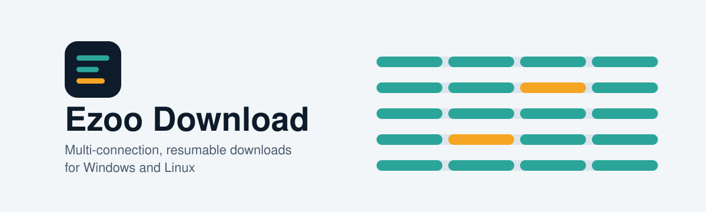
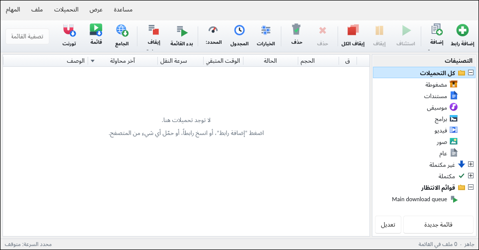
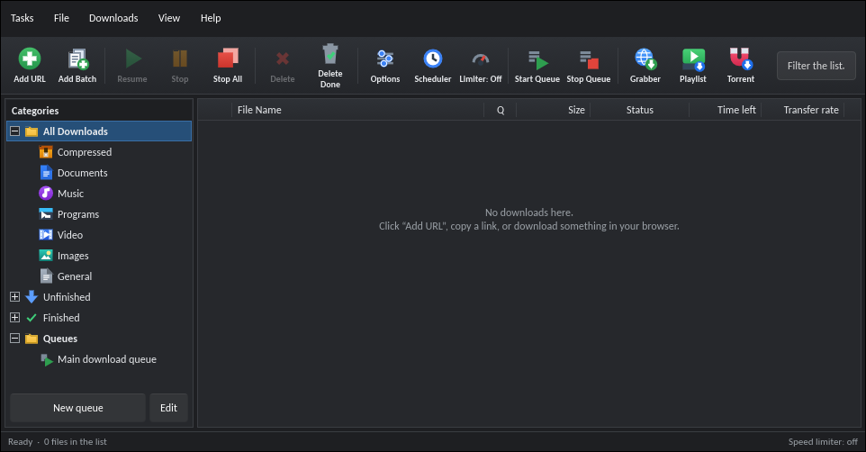
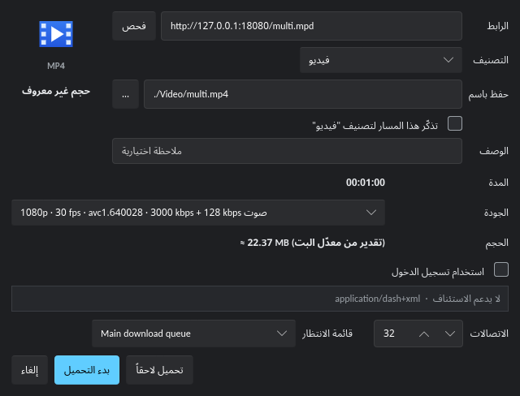
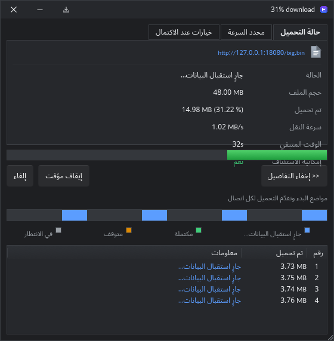

<div align="center">

<picture>
  <source media="(prefers-color-scheme: dark)" srcset="assets/banner-dark.svg">
  
</picture>

**تنزيلات متعددة الاتصالات وقابلة للاستئناف لويندوز ولينكس.**<br>
مجاني ومفتوح المصدر. دون إعلانات. دون حسابات.

[English](README.md) | [العربية](README.ar.md)

[](https://github.com/kerlif/ezoo-download/releases/latest)
[](https://github.com/kerlif/ezoo-download/releases)
[](#الترخيص)


<br>

<a href="https://github.com/kerlif/ezoo-download/releases/latest"> مثبّت ويندوز</a> &nbsp;&nbsp;&nbsp;
<a href="https://github.com/kerlif/ezoo-download/releases/latest"> حزم لينكس</a> &nbsp;&nbsp;&nbsp;
<a href="https://github.com/kerlif/ezoo-download/releases/latest"> إضافة المتصفح</a> &nbsp;&nbsp;&nbsp;
<a href="https://kerlif.github.io/ezoo-download/"> الموقع</a>

</div>

<br>

<div dir="rtl" align="right">

## لماذا Ezoo Download؟

| | الميزة | ما الذي يفعله |
|:-:|---|---|
|  | **اتصالات تكيّفية** | يقسّم كل ملف على ما يصل إلى 32 اتصالًا، ويعدّل العدد حسب ما يتحمّله الخادم واتصالك. يضيف اتصالات ما دامت السرعة ترتفع. |
|  | **استئناف حقيقي** | يكمل التنزيل بعد انهيار البرنامج أو إغلاقه أو انقطاع الاتصال. يُحفظ التقدم محليًا ويُتحقق منه عند الاستئناف. |
|  | **فيديو وصوت** | يقرأ قوائم HLS وDASH، ويعرض المدة والجودات المتاحة وحجمًا تقريبيًا يُعلَّم بالرمز ≈. |
|  | **التقاط من المتصفح** | إضافة كروم وفايرفوكس ترسل الرابط إلى البرنامج بنقرة واحدة. |
|  | **مجلدات تلقائية** | يرتّب الملفات المكتملة في مجلدات حسب نوعها. |
|  | **جدولة وقوائم انتظار** | يبدأ التنزيلات في موعد محدد، ويمكنه إطفاء الجهاز عند انتهاء القائمة. |
|  | **تحديد السرعة** | حدّ عام لكل التنزيلات، أو حدّ لتنزيل واحد. |
|  | **يعمل في الخلفية** | يبقى في شريط النظام بعد إغلاق النافذة. |
|  | **ثماني لغات** | الإنجليزية والعربية والفرنسية والإسبانية والألمانية والبرتغالية والتركية والروسية. |
|  | **وضع داكن** | تسع سمات مدمجة، منها الداكنة والسوداء — اختر ما يناسبك من الإعدادات. |
|  | **الخصوصية أولًا** | لا حسابات ولا تحليلات. الطلبان التلقائيان الوحيدان هما فحص التحديثات وفحص تحديث الأدوات اليومي، وكلاهما موثّق أدناه. |
|  | **دون إعلانات** | لا لافتات إعلانية ولا طلبات تبرع. |

> [!NOTE]
> في هذا الإصدار، اختيار الجودة في نافذة الالتقاط للمعلومات فقط، والتنزيل يستخدم الجودة الافتراضية.

## كيف يعمل؟

1. **انسخ الرابط.** يلتقطه البرنامج من الحافظة، أو تضيفه بنفسك.
2. **قسّم وحمّل.** يُقسَّم الملف على عدة اتصالات، ويتغيّر عددها أثناء التنزيل.
3. **أوقف واستأنف.** أوقف التنزيل، أو أغلق البرنامج، أو انقطع الاتصال. سيكمل من حيث توقف.

## لقطات من البرنامج

| | |
|:-:|:-:|
|  |  |
| الواجهة العربية، الوضع الفاتح | الوضع الداكن |
|  |  |
| نافذة الالتقاط: المدة والجودات والحجم | التفاصيل: الأجزاء لكل اتصال |

## التثبيت

<details>
<summary><b>ويندوز</b></summary>

1. نزّل ملف التثبيت من [أحدث إصدار](https://github.com/kerlif/ezoo-download/releases/latest).
2. شغّله. يُثبَّت لحسابك الحالي، ولا يحتاج صلاحيات المسؤول.

> [!WARNING]
> قد يعرض SmartScreen تحذيرًا لأن الملف غير موقّع بشهادة توقيع رقمية حتى الآن. تحقق من الملف مقابل `SHA256SUMS-windows.txt` قبل تشغيله، أو راجع الشيفرة المصدرية في هذا المستودع.

</details>

<details>
<summary><b>لينكس</b></summary>

اختر الصيغة المناسبة لتوزيعتك:

<div dir="ltr" align="left">

```bash
# Debian وUbuntu
sudo dpkg -i EzooDownload_*_amd64.deb

# Fedora وRHEL وopenSUSE
sudo dnf install ./ezoo-download-*.x86_64.rpm

# أي توزيعة، دون تثبيت
chmod +x EzooDownload-*-x86_64.AppImage
./EzooDownload-*-x86_64.AppImage
```

</div>

حزم `.deb` و`.rpm` وAppImage تتضمن ffmpeg، فدمج الفيديو والصوت يعمل دون تثبيت أي شيء آخر. وحزمة Flatpak غير مرفقة بإصدار 1.1.0 بعد — ما زالت قيد المراجعة، وستُضاف في إصدار لاحق.

للتفاصيل وحل المشكلات، راجع [دليل لينكس](packaging/linux/README-Linux.md).

</details>

<details>
<summary><b>إضافة المتصفح</b></summary>

نزّل حزمة كروم أو فايرفوكس من [أحدث إصدار](https://github.com/kerlif/ezoo-download/releases/latest).

- **كروم:** فكّ ضغط الملف، وافتح `chrome://extensions`، وفعّل وضع المطوّر، ثم اختر «تحميل إضافة غير مضغوطة».
- **فايرفوكس:** افتح ملف `.xpi`. قد يطلب فايرفوكس تأكيد التثبيت، وقد يرفض إضافات غير موقّعة.

</details>

<details>
<summary><b>البناء من المصدر</b></summary>

تحتاج إلى سلسلة أدوات Rust المستقرة وأدوات البناء الخاصة بنظامك.

<div dir="ltr" align="left">

```bash
git clone https://github.com/kerlif/ezoo-download.git
cd ezoo-download
cargo build --release
```

</div>

لبناء مثبّت ويندوز، شغّل `build-windows.ps1`. ولحزم لينكس، راجع [دليل لينكس](packaging/linux/README-Linux.md).

</details>

## الخصوصية والشبكة

- تذهب التنزيلات مباشرة من الخادم الذي اخترته إلى جهازك.
- طلبان تلقائيان فقط: فحص التحديثات (اسم البرنامج ورقم إصداره فقط، كل 24 ساعة — ويمكنك إيقافه من الإعدادات)، وفحص تحديث الأدوات الذي ينزّل yt-dlp وaria2 مرة يوميًا على الأكثر ويتحقق من هاشيهما قبل الاستخدام.
- ولا يعمل yt-dlp إلا عندما تطلب ميزات الفيديو أو قوائم التشغيل أو تحديث الأدوات.
- لا توجد تحليلات ولا تقارير أعطال ترسل تلقائيًا.

## الاستخدام المسؤول

> [!IMPORTANT]
> لا ينزّل Ezoo Download المحتوى المحمي بـ DRM، ولا يحاول تجاوز هذه الحماية. نزّل المحتوى الذي تملك حق تنزيله فقط، واتبع شروط كل موقع تستخدمه.

## الأسئلة الشائعة

<details>
<summary><b>هل البرنامج مجاني؟</b></summary>

نعم. لا توجد إعلانات ولا اشتراكات ولا ميزات مقفلة.

</details>

<details>
<summary><b>هل يدعم YouTube أو Netflix أو مواقع أخرى؟</b></summary>

لا يتعهد البرنامج بدعم موقع بعينه. البثوث المحمية بـ DRM تُرفض، ومعظم المحتوى المدفوع على منصات البث يستخدم هذه الحماية. والتنزيل من أي موقع قد يخالف شروطه، فتحقّق منها أولًا.

</details>

<details>
<summary><b>لماذا لا يغيّر اختيار الجودة ما يُنزَّل؟</b></summary>

في هذا الإصدار قائمة الجودات للمعلومات فقط، والتنزيل يستخدم الجودة الافتراضية. وقد تُضاف خاصية اختيار الجودة المؤثرة في إصدار لاحق.

</details>

<details>
<summary><b>هل يعمل على لينكس؟</b></summary>

نعم، عبر حزم `.deb` و`.rpm` وAppImage. وحزمة Flatpak مخطط لها في إصدار لاحق.

</details>

<details>
<summary><b>ماذا لو انقطع الاتصال؟</b></summary>

يحاول البرنامج استئناف التنزيل تلقائيًا. ويمكنك استئنافه بنفسك في أي وقت.

</details>

<details>
<summary><b>هل الشيفرة المصدرية متاحة؟</b></summary>

نعم، في هذا المستودع. والمشروع الأصلي من تطوير Ahmed Ezzat (Ezoo Tech).

</details>

## المساهمة

افتح مشكلة (Issue) للإبلاغ عن خطأ أو اقتراح ميزة. وتحسينات الترجمة مرحّب بها أيضًا.

## الترخيص

- المشروع الأصلي من تطوير **Ahmed Ezzat (Ezoo Tech)**.
- حزم لينكس وتطوير هذا المستودع من **kerlif**.
- ترخيص المشروع موجود في ملفات الترخيص داخل هذا المستودع، وتراخيص المكونات الخارجية مذكورة في `THIRD-PARTY-NOTICES.txt`.

</div>

<div align="center">

<br>


<br>

<sub>مبني بلغة Rust.</sub>

</div>
