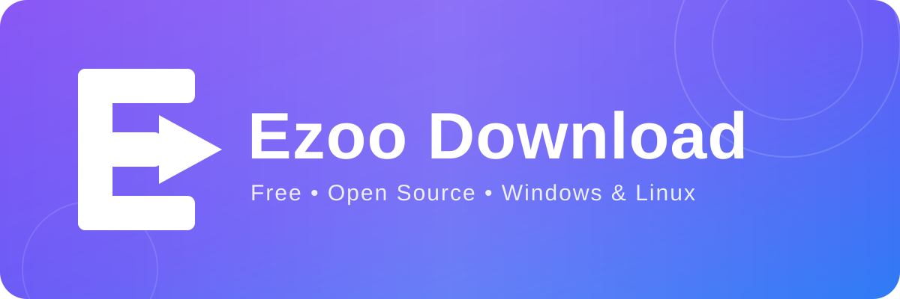
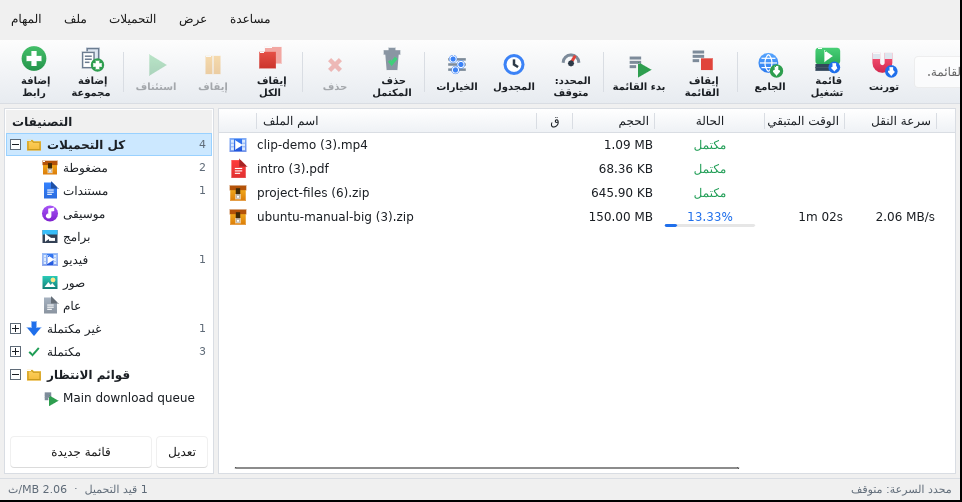
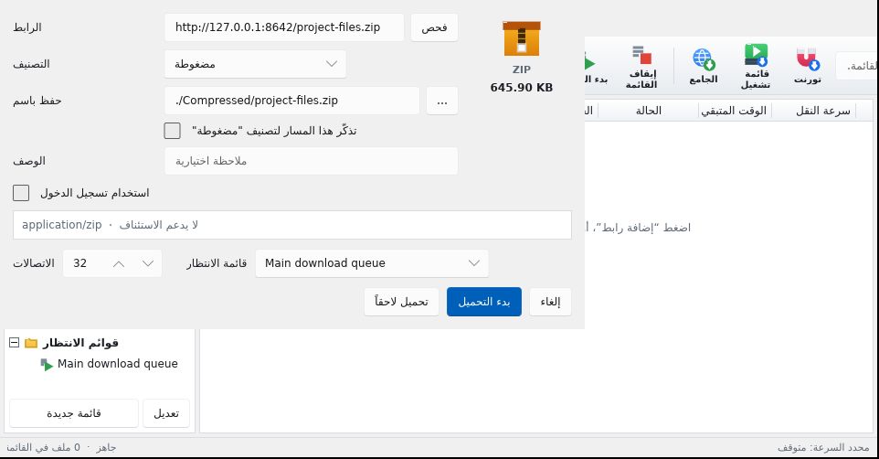

<div align="center">

### مدير تنزيلات سريع، مجاني، ومفتوح المصدر — لويندوز ولينكس

[](https://kerlif.github.io/ezoo-download/)
[](https://github.com/kerlif/ezoo-download/releases/tag/v1.0.7)
[](#)
[](#)

**[⬇️ تنزيل لويندوز (Setup.exe)](https://github.com/kerlif/ezoo-download/releases/download/v1.0.7/EzooDownload-Setup.exe)** · **[⬇️ تنزيل للينكس (.deb)](https://github.com/kerlif/ezoo-download/releases/download/v1.0.7/EzooDownload_1.0.7_amd64.deb)** · **[⬇️ تنزيل للينكس (AppImage)](https://github.com/kerlif/ezoo-download/releases/download/v1.0.7/EzooDownload-1.0.7-x86_64.AppImage)** · **[⬇️ تنزيل للينكس (.rpm)](https://github.com/kerlif/ezoo-download/releases/download/v1.0.7/ezoo-download-1.0.7-1.x86_64.rpm)**

</div>

---

## ما هو Ezoo Download؟

برنامج تنزيل بسيط وسريع: تعطيه رابط ملف، فيجلبه لك بأقصى سرعة ممكنة، ويكمل التنزيل من حيث توقف لو انقطع الاتصال — دون اشتراكات، ودون إعلانات، ودون حسابات.

يعمل على **ويندوز 10 و11** و**لينكس**، وواجهته بثماني لغات منها العربية.

## كيف يعمل؟

1. **انسخ رابط الملف** — البرنامج يلتقطه تلقائيًا من الحافظة، أو أضِفه بنفسك.
2. **قسّمه البرنامج على اتصالات متعددة** (حتى 32 اتصالًا) ليصل إلى أقصى سرعة يسمح بها اتصالك.
3. **استأنف في أي وقت** — أوقف التنزيل وأغلق البرنامج، وسيكمل من حيث توقف عند عودتك.

ومن المتصفح مباشرة: إضافة كروم وفايرفوكس ترسل الروابط إلى البرنامج بضغطة واحدة، بما فيها روابط الفيديو والصوت مع اختيار الجودة.

<p align="center">
  
  
  
</p>

## المزايا

| | |
|---|---|
| ⚡ **سرعة قصوى** | تقسيم كل ملف على اتصالات متعددة في الوقت نفسه |
| ⏯️ **استئناف حقيقي** | يكمل من حيث توقف، حتى بعد إغلاق البرنامج |
| 🎬 **فيديو وصوت** | من الصفحات وقوائم التشغيل، مع اختيار الجودة |
| 🌐 **إضافة للمتصفح** | كروم وفايرفوكس — التقاط الروابط بضغطة واحدة |
| 🗂️ **تنظيم تلقائي** | كل ملف يذهب إلى مجلده حسب نوعه |
| ⏰ **جدولة وقوائم انتظار** | شغّل في موعد محدد، وأوقف الجهاز عند الانتهاء |
| 🐢 **تحديد السرعة** | حدّ عام أو حدّ خاص بكل ملف |
| 🔔 **يعمل في الخلفية** | أيقونة بجوار الساعة، ويبقى يعمل عند إغلاق النافذة |
| 🌍 **ثماني لغات** | العربية، English، Français، Español، Deutsch، Português، Türkçe، Русский |
| 🔒 **خصوصيتك أولًا** | لا يجمع بياناتك ولا يرسل أي إحصاءات إلى أي جهة |

## التثبيت

### 🪟 ويندوز

نزّل [EzooDownload-Setup.exe](https://github.com/kerlif/ezoo-download/releases/download/v1.0.7/EzooDownload-Setup.exe) وثبّته — يُثبَّت للمستخدم الحالي ولا يحتاج صلاحيات المسؤول.

> قد تُظهر Windows SmartScreen تحذيرًا لأن البرنامج جديد وغير موقّع بشهادة رقمية بعد — الشيفرة المصدرية كاملة متاحة هنا للمراجعة.

### 🐧 لينكس

```bash
# Debian / Ubuntu
sudo dpkg -i EzooDownload_1.0.7_amd64.deb

# Fedora / RHEL / openSUSE
sudo dnf install ./ezoo-download-1.0.7-1.x86_64.rpm

# AppImage — أي توزيعة، دون تثبيت
chmod +x EzooDownload-1.0.7-x86_64.AppImage
./EzooDownload-1.0.7-x86_64.AppImage
```

نسخ لينكس تتضمن **ffmpeg مدمجًا** — دمج الفيديو والصوت وتحويل MP3 يعمل فورًا دون تثبيت أي شيء إضافي. للتفاصيل واستكشاف الأخطاء: [دليل لينكس الكامل](packaging/linux/README-Linux.md).

### 🌐 إضافة المتصفح

| المتصفح | الملف |
|---|---|
| Chrome (موقّعة) | [ezoo-download-chrome-1.0.7.crx](https://github.com/kerlif/ezoo-download/releases/download/v1.0.7/ezoo-download-chrome-1.0.7.crx) |
| Chrome (zip) | [ezoo-download-chrome-1.0.7.zip](https://github.com/kerlif/ezoo-download/releases/download/v1.0.7/ezoo-download-chrome-1.0.7.zip) |
| Firefox | [ezoo-download-firefox-1.0.7.xpi](https://github.com/kerlif/ezoo-download/releases/download/v1.0.7/ezoo-download-firefox-1.0.7.xpi) |

## الأسئلة الشائعة

**هل البرنامج مجاني فعلًا؟**
نعم — مجاني بالكامل، دون إعلانات ودون مزايا محجوبة خلف اشتراك.

**هل الشيفرة مفتوحة المصدر؟**
نعم. البرنامج مكتوب من الصفر بلغة Rust (clean room) دون نسخ كود أي برنامج آخر، والشيفرة كاملة في هذا المستودع.

**هل يعمل على لينكس؟**
نعم — `.deb` و`AppImage` و`.rpm`، مع أيقونة شريط وتشغيل تلقائي وffmpeg مدمج.

**ماذا لو انقطع الاتصال أثناء التنزيل؟**
يستأنف البرنامج من حيث توقف تلقائيًا، ويمكنك إيقافه واستئنافه يدويًا في أي وقت.

## روابط

- 🌐 [الموقع الرسمي](https://kerlif.github.io/ezoo-download/)
- 📦 [كل الإصدارات](https://github.com/kerlif/ezoo-download/releases)
- 🐧 [دليل لينكس الكامل](packaging/linux/README-Linux.md)
- 🐛 [الإبلاغ عن مشكلة](https://github.com/kerlif/ezoo-download/issues)

---

<div align="center">

المشروع الأصلي: **Ahmed Ezzat (Ezoo Tech)** · التطوير المنفصل ودعم لينكس في هذا المستودع: **kerlif**

© 2026 Ahmed Ezzat — جميع الحقوق محفوظة · تراخيص المكونات مفتوحة المصدر في `THIRD-PARTY-NOTICES.txt`

</div>
