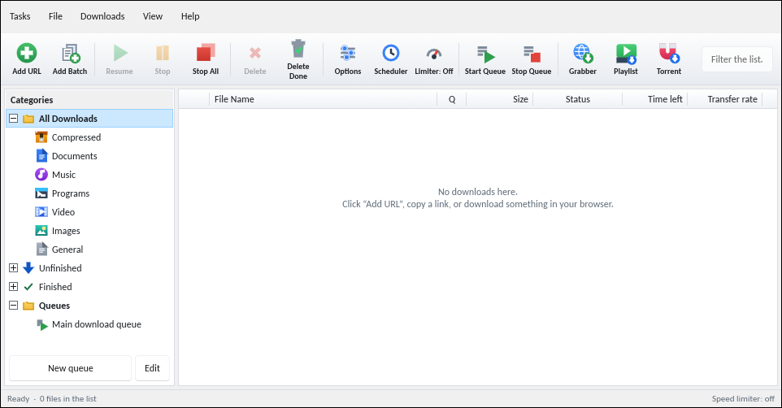

<div align="center">

<picture>
  <source media="(prefers-color-scheme: dark)" srcset="assets/banner-dark.svg">
  
</picture>

**Multi-connection, resumable downloads for Windows and Linux.**<br>
Free and open source. No ads. No accounts.

[English](README.md) | [العربية](README.ar.md)

[](https://github.com/kerlif/ezoo-download/releases/latest)
[](https://github.com/kerlif/ezoo-download/releases)
[](#license)


<br>

<a href="https://github.com/kerlif/ezoo-download/releases/latest"> Windows installer</a> &nbsp;&nbsp;&nbsp;
<a href="https://github.com/kerlif/ezoo-download/releases/latest"> Linux packages</a> &nbsp;&nbsp;&nbsp;
<a href="https://github.com/kerlif/ezoo-download/releases/latest"> Browser extension</a> &nbsp;&nbsp;&nbsp;
<a href="https://kerlif.github.io/ezoo-download/"> Website</a>

</div>

<br>

## Why Ezoo Download

| | Feature | What it does |
|:-:|---|---|
|  | **Adaptive connections** | Splits each file across up to 32 connections and adjusts their number to what your server and connection can handle. It adds connections while throughput keeps rising. |
|  | **Real resume** | Continues after a crash, a closed app, or a dropped connection. Progress is saved locally and checked when the download resumes. |
|  | **Video and audio streams** | Reads HLS and DASH playlists and shows the duration, the available qualities, and an estimated size marked with "≈". |
|  | **Browser capture** | The Chrome and Firefox extension sends a link to the app in one click. |
|  | **Automatic folders** | Sorts finished files into folders by type. |
|  | **Scheduling and queues** | Starts downloads at a set time and can shut the computer down when the queue is done. |
|  | **Speed limits** | A global limit, or a limit for a single download. |
|  | **Background mode** | Stays in the system tray after the window closes. |
|  | **Eight languages** | English, Arabic (right to left), French, Spanish, German, Portuguese, Turkish, and Russian. |
|  | **Dark mode** | Nine built-in themes, including Dark and Black — pick one in Settings. |
|  | **Private by design** | No accounts and no analytics. The only automatic network requests are the update check and a daily tool update check, both documented below. |
|  | **No ads** | No banners and no donation prompts. |

> [!NOTE]
> In this version, choosing a quality in the capture window is for information only. The download uses the default quality.

## How it works

1. **Paste a link.** The app picks it up from the clipboard, or you can add it yourself.
2. **Split and download.** The file is divided across several connections, and their number adapts while the download runs.
3. **Stop and resume.** Pause, close the app, or lose the network. The download continues from where it stopped.

## Screenshots

| | |
|:-:|:-:|
|  |  |
| Light theme | Dark theme |
|  |  |
| Capture dialog: duration, qualities, estimated size | Details: segments per connection |

## Installation

<details>
<summary><b>Windows</b></summary>

1. Download the installer from the [latest release](https://github.com/kerlif/ezoo-download/releases/latest).
2. Run it. It installs for your user account and does not need administrator rights.

> [!WARNING]
> Windows SmartScreen may show a warning, because the installer is not signed with a code-signing certificate yet. Check the file against `SHA256SUMS-windows.txt` before you run it, or review the source code in this repository.

</details>

<details>
<summary><b>Linux</b></summary>

Pick the format that fits your distribution:

```bash
# Debian and Ubuntu
sudo dpkg -i EzooDownload_*_amd64.deb

# Fedora, RHEL, openSUSE
sudo dnf install ./ezoo-download-*.x86_64.rpm

# Any distribution, no installation needed
chmod +x EzooDownload-*-x86_64.AppImage
./EzooDownload-*-x86_64.AppImage
```

The `.deb`, `.rpm`, and AppImage packages include ffmpeg, so merging video and audio works without installing anything else. A Flatpak bundle is not attached to the 1.1.0 release yet — it is still under review and will be added in a later release.

For troubleshooting, see the [Linux guide](packaging/linux/README-Linux.md).

</details>

<details>
<summary><b>Browser extension</b></summary>

Download the Chrome or Firefox package from the [latest release](https://github.com/kerlif/ezoo-download/releases/latest).

- **Chrome:** extract the zip, open `chrome://extensions`, turn on Developer mode, and choose **Load unpacked**.
- **Firefox:** open the `.xpi` file. Firefox may ask you to confirm the install, and it may refuse add-ons that are not signed.

</details>

<details>
<summary><b>Build from source</b></summary>

You need the stable Rust toolchain and the build tools for your platform.

```bash
git clone https://github.com/kerlif/ezoo-download.git
cd ezoo-download
cargo build --release
```

To build the Windows installer, run `build-windows.ps1`. For Linux packages, see the [Linux guide](packaging/linux/README-Linux.md).

</details>

## Privacy and network

- Downloads go directly from the server you chose to your computer.
- Two automatic network requests: an update check (app name and version only, every 24 hours — you can turn it off in settings), and a tool update check that fetches yt-dlp and aria2 at most once a day and verifies their checksums before use.
- yt-dlp runs only when you request video, playlist, or tool-update features.
- No telemetry, analytics, or automatic crash reports.

## Responsible use

> [!IMPORTANT]
> Ezoo Download refuses DRM-protected streams and does not try to bypass DRM. Download only content you have the right to download, and follow the terms of each website you use.

## FAQ

<details>
<summary><b>Is it free?</b></summary>

Yes. There are no ads, no subscriptions, and no locked features.

</details>

<details>
<summary><b>Does it support YouTube, Netflix, or other sites?</b></summary>

The app does not promise support for any specific site. Streams protected by DRM are refused, and much of the content on paid streaming services uses DRM. Downloading from any site may breach that site's terms of service, so check them first.

</details>

<details>
<summary><b>Why doesn't choosing a quality change the download?</b></summary>

In this version the quality list is for information only, and the download uses the default quality. Choosing a quality that changes the download may be added in a future release.

</details>

<details>
<summary><b>Does it run on Linux?</b></summary>

Yes, with `.deb`, `.rpm`, and AppImage packages. A Flatpak bundle is planned for a later release.

</details>

<details>
<summary><b>What happens if the connection drops?</b></summary>

The app tries to resume the download automatically. You can also resume it yourself at any time.

</details>

<details>
<summary><b>Is the source code available?</b></summary>

Yes, in this repository. The original project was written by Ahmed Ezzat (Ezoo Tech).

</details>

## Contributing

Open an issue to report a bug or suggest a feature. Translation fixes are welcome too.

## License

- The original project is by **Ahmed Ezzat (Ezoo Tech)**.
- Linux packaging and development in this repository are by **kerlif**.
- The project license is in this repository's license files. Third-party components are listed in `THIRD-PARTY-NOTICES.txt`.

<div align="center">

<br>


<br>

<sub>Built with Rust.</sub>

</div>
